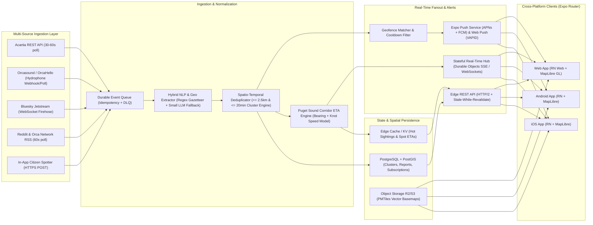

# SalishPulse — Real-Time Architecture & Cloud Cost Engineering

**Status:** Engineering Design Document (v1.0)  
**Target Region:** Puget Sound / Salish Sea (Seattle Waterfront, Admiralty Inlet, San Juan Islands, South Sound)  
**Client Platforms:** iOS, Android, and Web (Expo / React Native + React Native Web)

---

## 1. Executive Summary

**SalishPulse** is a near-real-time orca sighting aggregation, corroboration, and shore-viewing ETA platform for Seattle and Puget Sound. Sightings originate from fragmented, noisy, and bursty sources: citizen science networks (Acartia, Orca Network), acoustic hydrophone AI detectors (Orcasound / OrcaHello), real-time social firehoses (Bluesky Jetstream, Reddit/RSS), and in-app citizen spotters.

The traffic profile is **extremely bursty**: quiet winter weekdays may see 30–50 DAU, whereas a sunny Saturday with J-Pod swimming past Alki Point into Elliott Bay can trigger an instantaneous **20x–50x concurrent spike** (15,000+ concurrent map viewers, thousands of simultaneous push alerts, and hundreds of duplicate social posts within 10 minutes).

Our architecture optimizes for:
1. **Sub-30-second end-to-end latency** from source report or hydrophone detection to mobile push / live map update.
2. **Noise elimination via spatio-temporal corroboration** (collapsing 15 duplicate Alki posts into 1 high-confidence cluster).
3. **Edge-first fanout & spike immunity** so viral Elliott Bay events neither crash the spatial database nor generate runaway cloud bills.
4. **Pragmatic unit economics**: under $15/mo at MVP, ~$65/mo at 25k MAU, and <$260/mo even during a 100k MAU viral event.

---

## 2. End-to-End Near-Real-Time System Architecture

### 2.1 High-Level System Diagram

---

### 2.2 Multi-Source Ingestion Layer

Every upstream data provider is isolated behind a standardized `IngestionConnector` adapter emitting a normalized `RawSightingEvent` envelope `{ source, externalId, observedAt, rawText, rawLatLng?, mediaUrl?, metadata }`.

| Source | Transport & Cadence | Reliability & Rate-Limit Strategy | Signal Characteristics |
|---|---|---|---|
| **Acartia API** | HTTPS REST poll every 30–60s (`If-Modified-Since` / `since` cursor) | Exponential backoff + circuit breaker; respects API rate headers; idempotent on `acartia_id` | High trust, structured lat/lng, often includes pod/ecotype & heading |
| **Orcasound / OrcaHello** | Webhook receiver + 45s fallback poll on active hydrophone nodes (Bush Point, Orcasound Lab, Port Townsend, Sunset Bay, Point Robinson) | Deduplicated by `detection_id` + hydrophone node ID | Highest confidence acoustic presence; exact fixed hydrophone coords; no travel direction until paired with adjacent node or visual sighting |
| **Bluesky Jetstream** | Persistent WebSocket (`wss://jetstream2.us-west.bsky.network/subscribe?wantedCollections=app.bsky.feed.post`) | Lightweight edge worker filters for keywords (`orca`, `killer whale`, `j-pod`, `t65a`, `alki`, `puget sound`, `ferry`) before enqueueing | Sub-second latency; noisy text; requires NLP extraction & corroboration |
| **Reddit & RSS Feeds** | Scheduled poll every 60s (`r/Seattle`, `r/SeattleWA`, Orca Network RSS/Bluesky mirror) | Conditional `ETag` polling; `externalId = post_id` | Medium latency (1–5 min); rich context & landmark descriptions |
| **In-App Citizen Spotter** | `POST /api/sightings` (authenticated device token + Turnstile/rate limit) | Sliding-window rate limit (5 posts / 15 min / device); GPS accuracy metadata validated against Puget Sound bounding box | Structured form + optional free-text; instant optimistic UI confirmation |

---

### 2.3 Stream Processing & Intelligence Layer

#### 1. Durable Event Queue
All connectors enqueue raw payloads into a durable queue (Cloudflare Queues, SQS, or Pub/Sub) with:
- **Deterministic idempotency keys** (`sha256(source + externalId)` or `sha256(source + author + floor(ts/60s) + normalizedText)`) to prevent duplicate processing during retries.
- **Dead-Letter Queue (DLQ)** with 3 retries and exponential backoff so malformed social payloads never block live sightings.

#### 2. Hybrid NLP & Geospatial Extraction Pipeline
Parsing messy human posts like *"Just saw 3 orcas heading south past Alki Point toward Lincoln Park, huge tall dorsal fin right off the ferry lane!!"* must be both fast and cheap:

- **Stage A — Deterministic Fast Path (<2 ms, $0 cost, handles ~75–85% of traffic):**
  - Curated **Puget Sound Landmark Gazetteer** (50+ landmarks, ferry routes, lighthouses, and aliases: e.g., `"alki"` -> `47.5762, -122.4207`, `"fauntleroy ferry"` -> `47.5232, -122.3935`, `"point robinson"` -> `47.3883, -122.3742`).
  - Regex & lexical rules for cardinal/corridor direction (`northbound`/`NB`/`heading north` -> `N`, `"toward Lincoln Park"` relative to `"Alki"` -> bearing `S`), pod count (`"3 orcas"`, `"pod of 5"`, `"mom and calf"`), ecotype/pod hints (`"J-Pod"`, `"SRKW"`, `"T65A"`, `"Bigg's"`, `"transient"`, `"spyhopping"`, `"huge dorsal"`).
  - Returns a structured `ParsedSighting` with a parser confidence score.

- **Stage B — Small LLM Structured Fallback (~250–450 ms, ~$0.00015/post, handles ~15–25% ambiguous posts):**
  - Triggered only when Stage A detects whale keywords but fails to resolve coordinates, direction, or non-sighting intent (e.g., *"I wish I saw orcas at Alki today"* or *"Throwback photo from 2022"*).
  - Calls a fast, low-cost structured-output model (**Gemini 2.5 Flash-Lite**, **Claude Haiku**, or **GPT-4o-mini**) with strict JSON Schema output and a 2-second timeout.
  - Filters out false positives (`isLiveSighting: false` for news articles, throwbacks, and sports references like Vancouver Canucks).

#### 3. Spatio-Temporal Deduplication & Corroboration Engine
When J-Pod passes Alki Beach, 15+ people post within 10 minutes. Showing 15 overlapping pins ruins map readability and spams push alerts.

- **Clustering Rule:** Incoming sighting $S_{\text{new}}$ is matched against active clusters $C$ (updated within the last 60 minutes) using:
  - **Spatial threshold:** Haversine distance $\le 2.5\text{ km}$ (or $\le 4.0\text{ km}$ if projected forward along the cluster's travel vector $\vec{v}$).
  - **Temporal threshold:** $|\Delta t| \le 20\text{ minutes}$ from the cluster's `lastSeenAt`.
  - **Ecotype compatibility:** Do not merge confirmed `SRKW` with confirmed `Biggs` unless one is `unknown`.
- **Merge & Confidence Promotion:**
  - Updates cluster centroid using recency-weighted average (weighted toward higher-trust sources and newer timestamps).
  - Increments `corroborationCount` and appends source attribution (`sources: ['bluesky', 'acartia', 'citizen']`).
  - **Confidence Tier State Machine:**
    - `unverified` (score < 0.45): Single noisy social post without landmark precision.
    - `community` (0.45–0.74): Single structured citizen report or clear landmark social post.
    - `corroborated` (0.75–0.89): $\ge 2$ independent sources/reporters within the spatio-temporal window.
    - `verified` ($\ge 0.90$): Confirmed by Orcasound hydrophone, Acartia biologist/spotter, or $\ge 4$ independent corroborated reports.

#### 4. Puget Sound Corridor ETA Predictor
Orcas in Central Puget Sound travel predominantly along marine channels (Admiralty Inlet -> Main Basin -> East Passage / Colvos Passage -> Tacoma Narrows).

- **Model:**
  1. Compute great-circle distance $d$ (nautical miles) and bearing $\theta_{\text{spot}}$ from the active cluster's latest position to each shore viewing spot.
  2. Calculate alignment factor $\cos(\Delta \theta)$ between the pod's travel heading $\theta_{\text{pod}}$ and $\theta_{\text{spot}}$.
  3. Reject spots behind the pod ($\cos(\Delta \theta) < 0.25$) or outside corridor range ($> 18\text{ nm}$).
  4. Estimate speed $v$ in knots (default: `4.5 kn` for traveling SRKW, `5.5 kn` for Bigg's transients, `2.5 kn` if milling/foraging, or empirical speed computed from consecutive cluster observations).
  5. Compute `etaMinutes = (d / v) * 60` with an uncertainty window (`etaRangeMinutes: [min, max]`) and a `viewingLikelihood` (`high` / `medium` / `low`) incorporating cluster confidence, freshness decay, corridor alignment, and daylight/visibility heuristics.

---

### 2.4 Real-Time Fanout & Mobile Delivery

- **Read API (`GET /api/sightings`, `GET /api/spots`, `GET /api/hydrophones`):**
  - Served at the edge with `Cache-Control: public, max-age=5, stale-while-revalidate=30`.
  - During a 20x Elliott Bay spike, **99%+ of REST reads are served directly from edge cache/KV**, shielding Postgres completely.
- **Live Streaming (`GET /api/stream` via SSE / WebSockets):**
  - **Server-Sent Events (SSE)** is preferred over raw WebSockets for read-only sighting feeds: works cleanly over HTTP/2 multiplexing, auto-reconnects natively with `Last-Event-ID`, traverses corporate/mobile proxies cleanly, and avoids WebSocket upgrade overhead.
  - Terminated at stateful edge hubs (**Cloudflare Durable Objects** sharded by region, e.g., `puget-sound-central`, `san-juans`, `south-sound`). One Durable Object easily fans out 10,000+ concurrent SSE connections using Hibernation APIs without waking the database.
  - Emits typed events: `sighting:new`, `sighting:corroborated`, `eta:updated`, `hydrophone:pulse`.
- **Geofenced Push Alerts (Expo Push + Web Push):**
  - Users register alert subscriptions (`lat`, `lng`, `radiusKm`, `minConfidence`, `ecotypes`, `quietHours`, `expoPushToken` / `webPushSubscription`).
  - When a cluster reaches `community` (if opted-in) or `corroborated` / `verified`, a PostGIS spatial query (`ST_DWithin(user_geog, cluster_geog, radius_m)`) or projected-ETA match finds eligible subscribers.
  - **Anti-Spam Guardrails:**
    - Per-user, per-cluster cooldown (max 1 alert per cluster every 45 minutes unless the pod enters a brand-new viewing zone with ETA < 25 min).
    - Global user rate cap (max 4 pushes/day unless "Follow Active Pod" mode is toggled on).
    - Batched via Expo Push API (100 notifications per HTTP request) -> APNs & FCM.

---

### 2.5 Frontend Performance Architecture (Expo iOS / Android / Web)

| Concern | Implementation Strategy |
|---|---|
| **Unified Routing & Code Sharing** | **Expo Router** (file-based routing across iOS, Android, Web) + shared TypeScript domain/ETA utilities in `shared/` |
| **State & Network Caching** | **TanStack Query v5** with `staleTime: 15_000`, background refetch on focus, and direct SSE cache patching (`queryClient.setQueryData`) to eliminate redundant polling |
| **Optimistic Spotter UX** | Citizen spotter submissions immediately insert a pending pin into the map/feed cache (`onMutate`), rolling back only on hard error |
| **Offline Resilience** | Persisted TanStack Query cache (`react-native-mmkv` on native, `IndexedDB` on Web) + bundled Puget Sound shore spot directory & Be Whale Wise guide so users at coastal beaches with spotty LTE still see last-known pod positions and shore viewpoints |
| **Cross-Platform Maps** | **MapLibre RN** (`@maplibre/maplibre-react-native`) on iOS/Android + **MapLibre GL JS** on Web, consuming self-hosted **Protomaps PMTiles** (Pacific Northwest extract ~450 MB) from Cloudflare R2 -> **$0 per-map-load fees** even during viral traffic spikes |
| **60fps Zero-Jank UI** | `@shopify/flash-list` for sighting feeds, `react-native-reanimated` + `@gorhom/bottom-sheet` for gesture-driven map drawers, Supercluster for dense markers, memoized GeoJSON layers |

---

## 3. Cloud Provider & Pricing Comparison

### 3.1 Traffic Tiers & Workload Assumptions

| Metric | Tier 1: MVP / Beta | Tier 2: Seattle Growth | Tier 3: Viral J-Pod in Elliott Bay |
|---|---|---|---|
| **MAU / DAU** | 1,000 MAU / 50 DAU | 25,000 MAU / 2,500 DAU | 100,000 MAU / 15,000 DAU (20x spike: 20k concurrent on Sat) |
| **Sighting Clusters / mo** | ~200 | ~1,500 | ~4,000 (500+ raw posts/hr during spike) |
| **API + Tile Requests / mo** | ~150k API / ~300k tiles | ~4M API / ~10M tiles | ~35M API / ~80M tiles |
| **Live SSE Concurrent Peak** | 25 | 800 | 20,000 concurrent (3-hour viral window) |
| **Push Alerts / mo** | 5,000 | 150,000 | 1,000,000 |
| **LLM Fallback Calls / mo** | ~150 | ~1,500 | ~12,000 |
| **Database Size (PostGIS)** | < 100 MB | ~1.5 GB | ~8 GB |

---

### 3.2 Side-by-Side Stack Comparison (Estimated Monthly USD)

> **Note on Map Tiles & LLM Costs (Shared Across Stacks):**
> - **Protomaps PMTiles on Cloudflare R2** (zero egress fees): ~$0.01/mo storage + $0–$5/mo Class B ops -> **~$0–$8/mo** even at Tier 3 (compared to **$400–$2,500/mo** on commercial Mapbox/Google Maps tiles at Tier 3!).
> - **Small LLM Fallback (Gemini 2.5 Flash-Lite / GPT-4o-mini):** ~$0.05/mo (Tier 1), ~$0.50/mo (Tier 2), ~$4/mo (Tier 3).
> - **Expo Push API:** Free (wraps APNs & FCM directly; EAS Build optional at $0–$99/mo).

#### Stack A: Cloudflare + Supabase *(Recommended for MVP -> Growth -> Viral)*
*Components: Cloudflare Workers (API + Ingestion Cron + Jetstream Consumer via Durable Object), Cloudflare Queues, Durable Objects (SSE Fanout), Cloudflare R2 (PMTiles + photos), Supabase Postgres/PostGIS, Expo Push.*

| Component | Tier 1 (MVP) | Tier 2 (Growth) | Tier 3 (Viral Spike) |
|---|---:|---:|---:|
| Cloudflare Workers Paid Plan (10M req incl.) | $5 | $5 | $18 |
| Cloudflare Queues + Durable Objects (SSE) | $0 (incl.) | $5 | $35 |
| Cloudflare R2 (PMTiles + Sighting Photos, $0 egress) | $0 | $2 | $8 |
| Supabase Postgres + PostGIS (Free -> Pro -> Pro+Compute) | $0 | $25 | $110 |
| LLM Fallback + Expo Push + Domain/Monitoring | $2 | $8 | $25 |
| **Total Estimated Monthly Cost** | **$7 / mo** | **$45 / mo** | **$196 / mo** |

- **Pros:** Unbeatable spike economics (zero R2 egress, Durable Objects handle 20k SSE connections cleanly, Workers scale to 0ms cold starts globally including Seattle SEA PoP), native PostGIS in Supabase, tiny operational footprint.
- **Cons:** Workers runtime has minor Node.js compatibility constraints (must use Web-standard APIs / fetch); split vendor billing (Cloudflare + Supabase).

---

#### Stack B: AWS Serverless *(Best for Enterprise / AWS Activate Credits)*
*Components: API Gateway HTTP API + WebSocket API, AWS Lambda, EventBridge Scheduler + SQS, Aurora Serverless v2 (PostGIS) or DynamoDB, SNS/Pinpoint (or Expo Push), CloudFront + S3.*

| Component | Tier 1 (MVP) | Tier 2 (Growth) | Tier 3 (Viral Spike) |
|---|---:|---:|---:|
| API Gateway (HTTP + WebSocket connection-minutes) | $1 | $15 | $110 |
| AWS Lambda + SQS + EventBridge | $0 (Free Tier) | $8 | $45 |
| Database (Aurora Serverless v2 min 0.5 ACU w/ PostGIS)* | $44 | $65 | $190 |
| CloudFront + S3 (PMTiles + Static Web + Egress) | $2 | $22 | $145 |
| CloudWatch Logs + LLM + Expo/SNS | $3 | $15 | $45 |
| **Total Estimated Monthly Cost** | **$50 / mo** | **$125 / mo** | **$535 / mo** |

*\*Note: Replacing Aurora Serverless v2 with DynamoDB + Geohash drops Tier 1 to ~$8/mo and Tier 2 to ~$65/mo, at the expense of losing native PostGIS polygon/corridor queries.*

- **Pros:** Enterprise IAM, VPC isolation, mature IaC (CDK/Terraform), eligible for $5k–$100k AWS Activate startup credits, `us-west-2` (Oregon) is ~6ms from Seattle.
- **Cons:** Aurora Serverless v2 has a ~$44/mo floor (unless using auto-pause which adds 15s cold starts); API Gateway WebSockets + CloudFront egress get expensive during viral spikes; higher IAM/Terraform boilerplate.

---

#### Stack C: GCP Cloud Run + Firebase *(Best for Google/Firebase Mobile Teams)*
*Components: Cloud Run (API + Ingestion + SSE), Cloud Scheduler + Pub/Sub, Firestore (with GeoHash queries), Firebase Cloud Messaging (FCM), Cloud CDN + Cloud Storage.*

| Component | Tier 1 (MVP) | Tier 2 (Growth) | Tier 3 (Viral Spike) |
|---|---:|---:|---:|
| Cloud Run (min 0 -> min 1 -> auto-scale SSE instances) | $0 | $25 | $135 |
| Pub/Sub + Cloud Scheduler | $0 | $3 | $18 |
| Firestore (Reads/Writes + Realtime Listeners) | $0 | $35 | $240 |
| Cloud Storage + Cloud CDN (PMTiles + Egress) | $2 | $20 | $130 |
| FCM (Free) + LLM + Logging | $2 | $10 | $35 |
| **Total Estimated Monthly Cost** | **$4 / mo** | **$93 / mo** | **$558 / mo** |

- **Pros:** Extremely fast mobile prototyping; Firestore realtime snapshots replace custom SSE for simple clients; FCM is native and free; Cloud Run runs standard Node.js/TypeScript containers with zero runtime quirks.
- **Cons:** Firestore lacks native PostGIS spatial joins (requires geohash range hacks + client filtering); **viral spike risk**: 20,000 concurrent Firestore listeners receiving frequent cluster updates can trigger millions of billed document reads in a single afternoon.

---

#### Stack D: Fly.io + Managed PostGIS + Upstash Redis *(Best for Simple Container-First DevEx)*
*Components: Fly.io Machines (`sea` Seattle region!) running Node.js/TypeScript API + SSE + Ingestion, Neon or Supabase PostGIS, Upstash Redis (Pub/Sub + Rate Limiting + Cache), Cloudflare R2 for PMTiles.*

| Component | Tier 1 (MVP) | Tier 2 (Growth) | Tier 3 (Viral Spike) |
|---|---:|---:|---:|
| Fly.io Machines (`sea` region: 1x -> 2x -> 6x shared/perf VMs) | $6 | $28 | $140 |
| Managed PostGIS (Neon Launch / Supabase Pro) | $0 | $25 | $95 |
| Upstash Redis (Pub/Sub fanout + Cache) | $0 | $15 | $55 |
| Cloudflare R2 (PMTiles + Photos) | $0 | $2 | $8 |
| LLM Fallback + Expo Push + Monitoring | $2 | $8 | $25 |
| **Total Estimated Monthly Cost** | **$8 / mo** | **$78 / mo** | **$323 / mo** |

- **Pros:** Runs the exact Node.js/TypeScript backend (`backend/src/server.ts`) directly in Fly's **Seattle (`sea`) datacenter** with sub-10ms local latency; persistent WebSocket to Bluesky Jetstream is trivial inside a long-lived container; predictable flat VM billing; zero serverless cold starts.
- **Cons:** Must explicitly configure multi-machine autoscaling and Redis Pub/Sub fanout across Fly instances before viral spikes; slightly more ops ownership (container health, zero-downtime deploys) than fully managed serverless.

---

### 3.3 Summary Cost Comparison Table

| Stack | Tier 1 (MVP) | Tier 2 (Growth) | Tier 3 (Viral Spike) | Spike Resilience | Spatial Query Power |
|---|---:|---:|---:|---|---|
| **1. Cloudflare + Supabase** | **$7/mo** | **$45/mo** | **$196/mo** | Excellent (Edge + DO + $0 R2 egress) | Native PostGIS |
| **2. Fly.io (`sea`) + PostGIS + Upstash** | **$8/mo** | **$78/mo** | **$323/mo** | Strong (Auto-scale VMs + Redis Pub/Sub) | Native PostGIS |
| **3. AWS Serverless** | **$50/mo** | **$125/mo** | **$535/mo** | Strong (High egress/WS cost) | Native PostGIS (Aurora) |
| **4. GCP Cloud Run + Firebase** | **$4/mo** | **$93/mo** | **$558/mo** | Moderate (Firestore read-fanout cost risk) | Geohash workarounds |

---

## 4. Primary Recommendation & Migration Path

### Primary Recommendation: **Cloudflare + Supabase** (with Fly.io `sea` as Pragmatic Day-1 Alternative)

1. **For optimal long-term cost & viral spike immunity:** Choose **Cloudflare Workers + Queues + Durable Objects + R2 (PMTiles) + Supabase PostGIS + Expo Push**.
   - Costs **$7/mo** during beta, **$45/mo** at 25k Seattle MAU, and absorbs a 20,000-concurrent Elliott Bay J-Pod event for **under $200/mo**—primarily because Durable Objects decouple live SSE fanout from Postgres and R2 eliminates vector map tile egress charges.
2. **Pragmatic Day-1 Launch Option (Fastest Ship):** Deploy our existing Node.js/TypeScript backend directly to **Fly.io (`sea` Seattle region)** + **Supabase PostGIS** + **Cloudflare R2 (PMTiles)** for **$8/mo** at MVP. Because the backend runs standard Node 22 with persistent Bluesky Jetstream WebSockets and SSE in a single binary, you can launch in one afternoon and later offload SSE fanout & public read caching to Cloudflare Workers/Durable Objects when approaching 10k+ MAU.

### Migration Path to AWS (If AWS Activate Credits or Enterprise Compliance Apply)

To ensure zero vendor lock-in, keep all core domain logic (`nlpParser`, `deduplicator`, `etaEngine`, `connectors`) as pure, runtime-agnostic TypeScript modules behind clean interfaces:

| Phase | Trigger | Migration Action |
|---|---|---|
| **Phase 0 (Day 1)** | MVP Launch | Standard Postgres + PostGIS schema (pure SQL migrations, no Supabase-only lock-in), pure TS domain engine, R2 PMTiles |
| **Phase 1 (Credits)** | $5k–$25k AWS Activate Credits | Containerize `backend/` into **AWS ECS Fargate** or **App Runner** in `us-west-2` (Oregon) + **RDS PostgreSQL/PostGIS** (`db.t4g.micro` -> `db.r6g.large`) + **SQS**; keep Cloudflare in front as CDN/WAF + R2 tiles |
| **Phase 2 (Scale)** | >100k MAU / Multi-Region Pacific NW | Split ingestion workers into EventBridge + Lambda/SQS; add ElastiCache Redis for SSE fanout across ECS tasks; migrate push fanout to AWS SNS + Expo Push batch workers |

---

## 5. Wildlife Ethics & Production Guardrails

- **Be Whale Wise Compliance:** Every sighting card and viewing spot ETA prominently displays shore-based viewing guidance and Washington State vessel regulations (1,000-yard setback for Southern Resident Killer Whales effective 2025).
- **Anti-Harassment Safeguards:** Designed strictly for **land-based viewing** (parks, beaches, lighthouses, public ferry terminals); no boat-chase routing. Optional configurable 10-minute delay or slight spatial jitter for sensitive resting/foraging areas if requested by NOAA/Orca Network partners.
- **Graceful Degradation:** If Acartia, Bluesky, or Orcasound experiences downtime, circuit breakers isolate the failing connector while other sources and cached sightings continue serving seamlessly.
