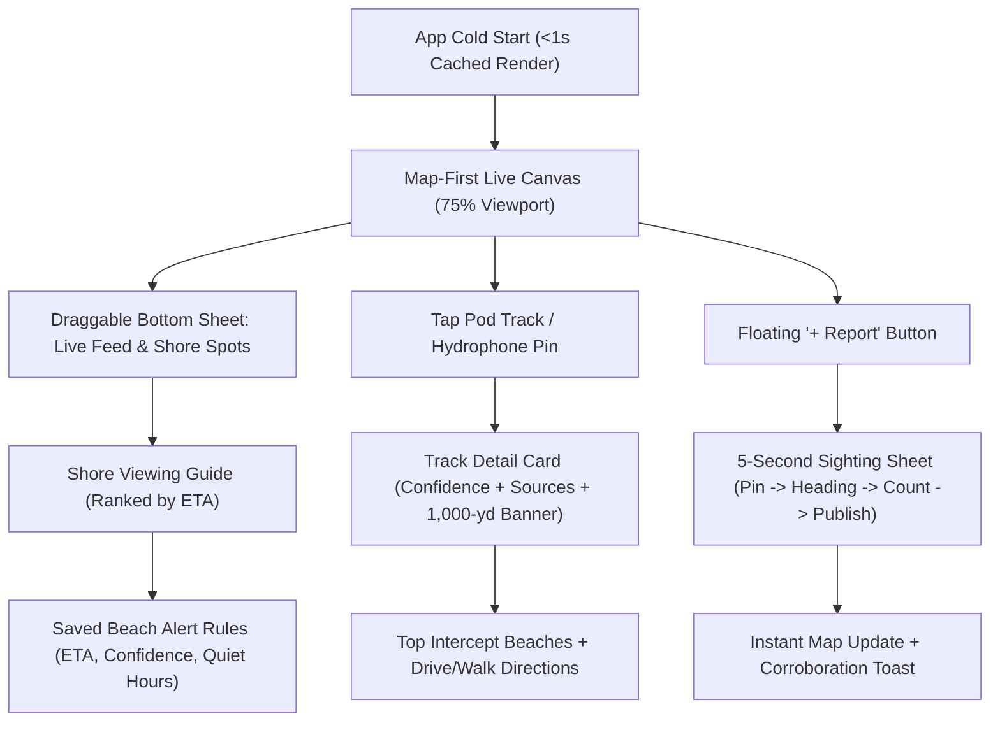
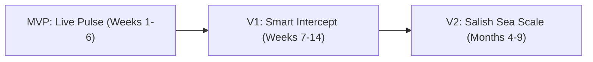

# SalishPulse — Product Requirements Document (PRD)

| Metadata | Details |
| :--- | :--- |
| **Product Name** | **SalishPulse** *(Working Title — see Naming Options below)* |
| **Document Owner** | Principal Technical Product Manager |
| **Status** | Draft v1.0 — Ready for Engineering, Design & Stakeholder Review |
| **Target Platforms** | iOS, Android, Responsive Web (Single codebase via React Native / Expo) |
| **Primary Geography** | MVP: Puget Sound & Admiralty Inlet (Olympia to Port Townsend) · V2: Greater Salish Sea & San Juan Islands |

---

## 1. Product Vision & Positioning

### 1.1 The Problem
Watching wild orcas from the beaches of Seattle and Puget Sound is one of the most magical urban wildlife experiences on Earth—yet discovering *when* and *where* to go is painfully fragmented and slow. Today, a Seattle resident trying to catch Southern Resident Killer Whales (SRKWs) or Bigg's (Transient) orcas must manually refresh:
- Multiple Facebook groups (Orca Network Community Group, Puget Sound Whale Sightings) buried under algorithmic sorting and comment threads,
- Separate hydrophone web pages (Orcasound) with no unified spatial map,
- Disparate Bluesky / X accounts, WhatsApp threads, and marine mammal databases (Acartia / WhaleReport).

Because whales move through Puget Sound at **3–7 knots**, a 20-minute delay in spotting a Facebook comment is the difference between watching J-Pod breach off Alki Point and staring at empty water. Conversely, over-eager alert tools cause severe **notification fatigue** (spamming users about whales 40 miles away or swimming in the opposite direction) or risk **unethical vessel swarming** if raw water coordinates are broadcast irresponsibly.

### 1.2 Product Vision
**SalishPulse is the sub-second, map-first "Waze for shore-based whale watching" across Seattle and Puget Sound—built conservation-first.**

We unify acoustic hydrophones, verified sighting networks, social signals, and structured citizen reports into one clean, glanceable live pulse, answering one question instantaneously:
> **"Are whales heading toward a beach near me right now, how confident are we, and how many minutes do I have to get there?"**

### 1.3 Positioning & Explicit Non-Goals
- **Amplifier, Not a Replacement:** SalishPulse credits, deep-links to, and feeds structured citizen sightings *back upstream* to conservation pillars like **Orca Network**, **Acartia**, and **Orcasound**.
- **Shore-First, Conservation-First:** Every UX choice optimizes for land-based viewing (beaches, bluffs, ferry terminals) and active legal compliance with Washington State's **1,000-yard SRKW buffer**.
- **Explicit Non-Goals (Out of Scope):**
  1. **Not a boat-chasing / vessel interception tool:** We will never provide precision boat-navigation routing toward whales or high-precision real-time GPS pins on open water.
  2. **Not a social media feed:** No algorithmic engagement loops, vanity follower counts, or noisy comment threads competing with the map.
  3. **Not an exhaustive marine-biology archive:** Deep historical catalog research remains the domain of the Center for Whale Research (CWR) and Orca Network archives.

### 1.4 Naming Recommendations
| Candidate | Rationale | Recommendation |
| :--- | :--- | :--- |
| **SalishPulse** *(Working Title)* | Evokes live acoustic + visual heartbeat of the Salish Sea; scalable beyond Seattle to BC/San Juans; distinct from existing orgs. | **Recommended (Primary)** |
| **SoundFin** | Short, ultra-local ("Puget Sound" + dorsal fin); great app icon potential, slightly narrower if expanding to BC. | Strong Runner-Up |
| **OrcaLine** | Clear utility ("whale line" / ETA trajectory); slightly utilitarian and risks confusion with existing whale hotlines. | Backup |

---

## 2. Target Personas & Jobs-to-Be-Done (JTBD)

| Persona | Profile | Trigger | Core Job-to-Be-Done (JTBD) | Current Pain | SalishPulse Outcome |
| :--- | :--- | :--- | :--- | :--- | :--- |
| **1. Spontaneous Seattle Local ("Maya")** | West Seattle / Ballard / Bainbridge resident; owns binoculars, loves nature, busy job. | Whales enter Central Sound within 45 min of her nearest beach. | *"Tell me if J-Pod is passing Alki in the next 30 minutes so I can grab my jacket, check parking, and walk down—without buzzing my phone all week."* | Learns about sightings 2 hours late on Instagram/Facebook; quits alert groups due to noise. | Receives 1 high-confidence ETA push (`J-Pod SB · ETA 25–40m to Alki`), opens map in <1s, catches the pass. |
| **2. Dedicated Spotter / Photographer ("Devon")** | Edmonds / Whidbey / Tacoma regular; carries 400mm lens; tracks specific matrilines. | Any confirmed SRKW or Bigg's entry into Admiralty Inlet or Main Basin. | *"Give me verified ecotype, pod ID, travel vector, multi-source corroboration, tide/lighting context, and recent track history so I pick the exact bluff."* | Juggles 5 browser tabs (FB, Orcasound, Windy, tide charts, MarineTraffic) while driving or standing in rain. | Single split-second view: pod vector + confidence score + corroborating sources + sunset/tide card per bluff. |
| **3. Citizen Scientist / Ferry Commuter ("Priya")** | Rides Bainbridge–Seattle or Edmonds–Kingston WSF ferry daily. | Spots dorsal fins from the sun deck with spotty cell service. | *"Let me log location, heading, and count in 5 seconds with one thumb so fellow locals see them and Orca Network / Acartia gets clean data."* | Typing a Facebook post with GPS/direction takes too long; posts lose structure and fail offline on the boat. | 1-tap offline-resilient reporter auto-captures GPS/ferry lane, heading, and count; syncs upstream automatically. |
| **4. Conservation Advocate / Boater ("Sam")** | Puget Sound kayaker, sailor, or marine steward. | Active whale presence along a waterway they are paddling/transiting. | *"Instantly tell me whether nearby whales are endangered SRKWs (1,000 yd mandatory WA buffer) or Bigg's (200 yd) so I can shut down/yield early."* | Unsure which ecotype is ahead; legal distance rules changed in Jan 2025 (1,000 yds for SRKW) and vary by ecotype/border. | Unmistakable contextual ecotype badge + mandatory buffer banner + acoustic/visual proximity warning. |

---

## 3. Core Feature Requirements (Prioritized P0 / P1 / P2)

### 3.1 Priority Overview Matrix

| Feature Area | P0 — MVP (Launch) | P1 — Fast-Follow (Chum Season) | P2 — Scale (Salish Sea) |
| :--- | :--- | :--- | :--- |
| **F1. Live Map Tracker** | Map-first Puget Sound canvas, recency rings, trajectory vectors, viewing pins, hydrophone badges | 24h track replay time-scrubber, WSF ferry route overlay, live daylight/sunset terminator | Full Salish Sea & BC expansion, customizable nautical chart layers |
| **F2. Aggregated Sighting Feed** | Orca Network/Acartia + Orcasound + Bluesky + Community ingestion, 3-tier confidence badges, dedup clustering | Spotter reputation scores, pod/matriline filter chips (J/K/L, Bigg's, Humpback, Gray) | AI-assisted dorsal/saddle-patch ID hints (human-verified), historical seasonal heatmaps |
| **F3. Smart ETA Alerts** | Saved-beach geofences, heading-toward-you filter, ETA threshold (<45m), cooldown dedup, quiet hours | Channel-graph waterway ETA routing (around Vashon/Bainbridge), iOS Live Activities / Android ongoing ETA | Dynamic commuter/ferry-crossing alerts, acoustic-only night-owl mode |
| **F4. Shore Viewing Guide** | Top 20 Seattle/Puget Sound beaches ranked by live intercept ETA + distance, parking/vantage tips | Live NOAA tide state, wind/glare score, golden-hour countdown per beach | Community-curated accessibility tags (stroller/ADA/dog-friendly/restrooms) |
| **F5. 1-Tap Sighting Reporter** | <5s flow (auto-GPS/pin -> direction -> count/ecotype -> optional photo/note), offline queue | Automated opt-in export bridge to Acartia & Orca Network, post-alert *"Did you spot them?"* check-in | Verified-spotter fast-track badge & photo EXIF-stripped gallery per pod track |
| **F6. Hydrophone Pulse** | Live Orcasound node status badges + OrcaHello detection pulse + 1-tap deep-link to live audio | Embedded low-latency HLS background audio player with live call-detection waveform markers | Multi-hydrophone listening room alerts + community "I hear calls" quick tag |
| **F7. Conservation Guardrails** | Dynamic 1,000-yd SRKW / 200-yd Bigg's banner, ~750m water-pin coarsening, EXIF stripping | Conservation Partner Admin Freeze/Delay switch (NOAA/WDFW/Orca Network advisories) | Cross-border auto-switching (WA 1,000-yd vs. BC DFO 400m SRKW / 200m Bigg's) |

---

### 3.2 Detailed Functional Specifications

#### F1. Interactive Map-First Live Tracker (P0)
- **Viewport Default:** Opens immediately to a full-bleed Puget Sound coastal map centered on the user's primary saved area (default: Central Puget Sound — Edmonds to Point Defiance), showing all sightings from the last **4 hours** (configurable: 2h / 4h / 12h / 24h).
- **Pod Track Markers & Animated Recency Rings:**
  - **Active (<15 min):** High-contrast pulsing sonar ring + ecotype icon (distinct styling for SRKW vs. Bigg's vs. Baleen/Humpback/Gray).
  - **Recent (15–60 min):** Solid ring with elapsed badge (`28m ago`).
  - **Aging (1–4 hrs):** Muted translucent pin (`2h ago`) to convey trajectory without implying immediate presence.
- **Trajectory Vectors:** For any pod track with a reported heading or >=2 corroborated points, render a subtle directional cone/dashed centerline vector projecting the next **30–60 minutes** of likely travel.
  - *Critical Puget Sound Geometry Rule (P1 upgrade, simplified P0):* Vectors must respect land barriers—whales swim through **Admiralty Inlet**, **Main Basin**, **East Passage**, and **Colvos Passage**, never overland across Vashon or Bainbridge Island.
- **Map Overlays:** Toggleable layers for Curated Viewing Spots (colored by live status: `Active Now`, `Inbound <45m`, `Quiet`) and Orcasound Hydrophone Nodes.

#### F2. Real-Time Aggregated Sighting Feed & Confidence Engine (P0)
- **Multi-Source Ingestion:** Normalizes events into a single schema from:
  1. **Orca Network / Acartia** (authoritative structured sightings),
  2. **Orcasound / OrcaHello** (acoustic AI + human-verified hydrophone detections),
  3. **Bluesky** (curated Puget Sound whale-spotter lists & structured hashtags, parsed via lightweight NLP/geo-matcher),
  4. **SalishPulse Community** (in-app 1-tap reports).
- **Source Attribution:** Every sighting card displays crisp **Source Pills** (e.g., `Orca Network`, `Orcasound · Bush Pt`, `Bluesky`, `Community · 4 reports`) with original timestamp and 1-tap attribution link to the raw upstream post where applicable.
- **Spatio-Temporal Deduplication (Anti-Spam Clustering):**
  - Reports matching the same ecotype/species (or `Unknown Orca` + confirmed ecotype) within **3 nautical miles** along the same waterway channel and **20 minutes** are merged into a single **Pod Track Event** rather than spawning duplicate pins.
  - Each merged report increments the track's corroboration counter and extends/refines its trajectory vector.
- **3-Tier Confidence Scoring Model:**

| Tier | Score Range | Visual Treatment | Criteria | Default Push Eligibility |
| :--- | :---: | :--- | :--- | :---: |
| **Verified** | `85–100` | Solid Teal Shield Badge | Official Orca Network/Acartia verified, Orcasound human-confirmed acoustic call, OR >=2 trusted/reputation spotters, OR 1 trusted spotter + corroborating photo. | **Yes (Default)** |
| **Corroborated** | `55–84` | Amber Ring Badge | >=2 independent community/social reports within cluster window, OR OrcaHello high-confidence AI acoustic hit pending human check. | Opt-in (`Corroborated+`) |
| **Unverified** | `0–54` | Muted Dashed Gray Pill | Single uncorroborated community or social report; auto-expires faster (60 min) if unconfirmed. | Opt-in (`All Sightings`) |

#### F3. "Heading Toward You" Smart ETA Alerts & Anti-Fatigue Engine (P0)
Users abandon whale apps because of two failure modes: *too late* or *too noisy*. SalishPulse treats alert precision as a P0 core product differentiator.
- **Target Anchors:** Users save 1–5 favorite shore beaches (e.g., *Alki Point*, *Golden Gardens*, *Point Robinson*)—no creepy always-on background GPS required.
- **ETA Calculation:** Computes waterway distance from the latest corroborated track point to each saved beach divided by ecotype travel speed band (**SRKW: 3–5 knots**; **Bigg's: 4–7 knots**), outputting a realistic arrival range (e.g., *"ETA 20–35 min to Alki Point"*).
- **5 Built-In Anti-Fatigue Guardrails:**
  1. **Travel-Direction Filter (On by Default):** Suppress alerts if the pod's heading vector is moving *away* from the saved beach or across an unconnected basin.
  2. **ETA Horizon Cutoff:** User sets max lead time (`<30 min`, `<45 min` [Default], `<60 min`, or `Any Puget Sound`).
  3. **Confidence Gate:** Defaults to `Verified` only; configurable to `Corroborated+` or `All`.
  4. **Deduplication Cooldown:** Maximum **1 notification per Pod Track per Saved Beach per 60 minutes**. *Allowed override:* One immediate follow-up if the pod upgrades from `Unverified` -> `Verified` while inbound, or enters `<15 min` ("Passing Alki Point NOW").
  5. **Daylight-Aware Quiet Hours:** Automatically silences visual shore alerts from **sunset + 30 min to sunrise − 30 min** (adjustable in settings, with a separate opt-in toggle for overnight hydrophone audio alerts).
- **Notification Payload Copy Standard:** Actionable in a 1-second glance on a lock screen:
  > **J-Pod (SRKW) heading South · ETA 25–40 min to Alki Point**
  > Last confirmed off West Point (6m ago) · Verified (Orca Network + 3 local reports)

#### F4. Shore Viewing Guide (P0 core / P1 environmental context)
- **Curated Launch Directory (20 Premier Puget Sound Spots):**
  - *Seattle Metro:* Alki Point Lighthouse, Constellation Park, Lincoln Park (North Beach), Discovery Park (West Point), Golden Gardens, Carkeek Park, Magnolia Bluff.
  - *North Sound / Whidbey:* Richmond Beach, Edmonds Marina/Brackett's Landing, Mukilteo Lighthouse Park, Fort Casey, Bush Point, Lagoon Point.
  - *South Sound / Kitsap / Vashon:* Point Robinson Lighthouse, Owen Beach / Point Defiance, Dune Peninsula, Titlow Beach, Fay Bainbridge, Fort Ward, Manchester State Park.
- **Dynamic Ranking:** Default sort = **Live Intercept Score** (Active Now -> Inbound ETA shortest first -> Distance).
- **Spot Card Data:** Live status pill, estimated ETA window, drive/transit distance, elevation/viewing-angle tips (*"Bring binoculars; whales often hug the Vashon side"*), parking notes, and (P1) **NOAA tide direction + sunset/golden-hour timer**.

#### F5. 1-Tap Sighting Reporter (P0)
- **Design Goal:** Complete and submit a high-value sighting in **<=5 seconds** with cold hands on a moving ferry deck.
- **Streamlined Flow:**
  1. Tap floating **`+ Report`** button.
  2. **Where:** Auto-locks user GPS with a 1-tap toggle: `From Shore (Looking Out)` (prompts quick water tap on mini-map so whales aren't pinned on land!) or `On Ferry / Water`.
  3. **Direction:** Large thumb-friendly compass wheel (`North`, `South`, `East`, `West`, `Milling / Feeding`, `Unsure`).
  4. **Who & How Many:** Quick chips (`Orcas`, `Humpback`, `Gray`, `Other`) + Group size (`1–3`, `4–10`, `10+`) + optional ecotype (`SRKW`, `Bigg's`, `Unsure`).
  5. **Optional:** 1-tap camera/photo picker or brief note -> **Publish**.
- **Resilience & Feedback Loop:**
  - **Offline Queue:** Captures exact observation timestamp + coordinates locally when cell signal drops on WSF ferries and auto-uploads immediately on reconnect.
  - **Corroboration Boost:** If the report lands within an active cluster, UI responds with instant delight: *"Thanks! Your report corroborated an active J-Pod track (+1 confirmation)."*
  - **Upstream Civic Sync (P1):** Opt-in checkbox (*"Share with Orca Network & Acartia"*) formats and routes submissions to regional conservation partners.

#### F6. Hydrophone Acoustic Pulse (P0 status / P1 inline audio)
- Displays live nodes across Puget Sound (Bush Point, Sunset Bay, Point Robinson, Port Townsend, Orcasound Lab).
- **Node States:** `Orca Calls Detected` (animated teal acoustic wave), `Listening Live` (calm pulse), `Offline/Maintenance` (gray).
- **P0 Action:** Tapping a node opens a compact bottom card showing recent OrcaHello detections + 1-tap deep-link to `live.orcasound.net`.
- **P1 Upgrade:** Native background-capable HLS audio player so users can listen to Point Robinson hydrophone audio while watching the live map.

#### F7. Conservation, Ethics & Privacy Guardrails (P0 — Non-Negotiable)
- **Contextual Conservation Banner:** Persistently surfaces clean, unobtrusive legal guidance whenever an active sighting is viewed:
  - **SRKW or Unidentified Orca (WA Waters):** *"Endangered Southern Resident Orcas — WA law requires vessels to stay **1,000 yards** away & slow to <7 knots nearby. Enjoy from shore!"* (Reflects WA RCW 77.15.740, effective Jan 1, 2025).
  - **Confirmed Bigg's (Transient) Orcas:** *"Bigg's Orcas — Be Whale Wise requires **200 yards** vessel distance (400 yds in BC). Keep engines low & watch from land."*
- **Anti-Swarming Spatial Coarsening:** Public map pins on open water are intentionally snapped/jittered to a **~750-meter waterway zone / soft halo** rather than pinpoint GPS coordinates. This preserves 100% utility for shore-based binocular watchers and ETA predictions while neutralizing real-time boat-chasing risk.
- **Conservation Freeze / Delay Switch (P1):** Authenticated admin toggle for vetted partners (Orca Network, WDFW, NOAA) to apply a **30–60 minute public delay** or temporary zone blackout during sensitive biological events (e.g., distressed individual, newborn calf, active entanglement response), replacing pins with an educational conservation advisory.
- **User Privacy:** Zero background GPS tracking by default (alerts bind to static saved beaches); EXIF GPS metadata automatically stripped from all uploaded photos; zero third-party ad-tech SDKs.

---

## 4. UX Architecture & Performance Principles

### 4.1 Core Navigation & User Flows

### 4.2 Sub-1s Perceived Load & Performance Budget
| Metric | Target | Architectural Mandate |
| :--- | :--- | :--- |
| **Cold Start to Interactive Map** | **< 1,000 ms** (p90 on LTE) | Stale-while-revalidate local cache (MMKV / IndexedDB) renders cached Puget Sound sightings & viewing spots on frame 1 before network resolves. |
| **Initial Payload (GeoJSON Snapshot)** | **< 40 KB** gzipped | Edge-cached CDN snapshot refreshed every 15s (Cloudflare/Fastly) containing active 24h clustered tracks + hydrophone statuses. |
| **Live Delta Updates** | **< 500 ms** UI reflection | Lightweight Server-Sent Events (SSE) stream for active foreground sessions; zero heavy REST polling loops. |
| **Map Frame Rate** | **60 fps** pan/zoom | Native vector map rendering (MapLibre / Mapbox GL) with pre-clustered GeoJSON sources and GPU-driven recency ring animations. |
| **Web Lighthouse Performance** | **>= 90** mobile score | Code-split secondary sheets, lightweight vector icons, zero heavy web-font blocking. |

### 4.3 Visual Design & Ergonomics
- **Pacific Northwest Maritime Aesthetic:** Clean, atmospheric, zero dashboard clutter.
  - **Salish Dark (Default Evening/App):** Deep Puget slate (`#0B1924`), elevated marine navy (`#132636`), crisp fog white (`#F0F4F8`), kelp-teal active signal (`#2EC4B6`), lighthouse amber alerts (`#F4A261`), conservation coral (`#E76F51`).
  - **Daylight Fog (High-Contrast Outdoor Mode):** Auto-switches or toggles for direct sunlight readability on windy beaches and ferry decks (crisp coastal mist `#F4F7F9`, deep ink `#0D1B2A`, saturated marine accents).
- **Responsive Layouts:**
  - **Mobile (iOS / Android):** Map-first canvas with 3-detent draggable bottom sheet (*Peek: Live status summary* · *Half: Active feed + top inbound beaches* · *Full: Detailed feed/guide*). All primary controls (Center, Layers, Alerts, `+ Report`) live within bottom-third thumb reach.
  - **Desktop Web:** Instant 2-pane split layout — left 380px rail (Live Feed / Viewing Spots / Hydrophones tabs) paired with full-height interactive Puget Sound map on the right.

---

## 5. Product Metrics & North Star KPIs

### North Star Metric
> **Verified Shore Intercepts per Week** — Number of unique users who engage with an active track or ETA alert and confirm a successful shore-based whale sighting (measured via lightweight 1-tap post-alert check-in *"Did you spot them?"* or corroborated sighting report).

### Core Product & Operational KPIs

| Category | Metric | Target | Guardrail / Alert Threshold | Measurement Method |
| :--- | :--- | :--- | :--- | :--- |
| **Speed** | **End-to-End Alert Latency** | **< 90 sec** (p90) from upstream source post to push delivery | > 180 sec triggers P1 engineering alert | Ingestion timestamp minus source `created_at` + push gateway ack |
| **Utility** | **Alert-to-Sighting Conversion** | **>= 25%** of alert openers report seeing whales | < 12% triggers ETA speed/routing calibration | 1-tap follow-up prompt sent 45 min after user taps *"Heading Out"* |
| **Trust** | **Verified-Tier False-Positive Rate** | **< 5%** of `Verified` alerts retracted/disputed | >= 8% tightens corroboration score threshold | Moderator retractions + community "Not Orcas / No Sighting" flags |
| **Anti-Fatigue** | **Monthly Alert Opt-Out Rate** | **< 8%** of active push subscribers disable alerts | >= 12% triggers default cooldown/filter review | Push permission state changes + in-app beach alert toggles |
| **Growth & Retention** | **Peak-Season WAU (Oct–Jan Chum Run)** | **10,000+ WAU** (V1) · **>= 35% D30 retention** | < 20% D30 retention during active whale weeks | Product analytics (privacy-preserving, no PII tracking) |
| **Community** | **Citizen Reporting Contribution** | **>= 10%** of monthly actives submit >=1 structured report | < 80% valid schema completion | Reporter funnel telemetry & upstream partner acceptance rate |
| **Conservation** | **SRKW Banner Impressions & Zero Harassment** | **100%** SRKW views show 1,000-yd banner; **0** linked incidents | Any partner ethics complaint triggers immediate audit | Client banner render audit + partner feedback channel |

---

## 6. Phased Delivery Roadmap

### Phase 0 — MVP: "Live Pulse" (Weeks 1–6)
**Goal:** Ship a blazing-fast, reliable Puget Sound live map + low-noise alert engine to validate core utility with 500–1,000 beta Seattle locals and spotters.
- Single React Native / Expo app (iOS TestFlight, Android internal track, responsive Web live at launch).
- Live ingestion pipeline for **Orca Network / Acartia**, **Orcasound**, **Bluesky** curated spotters, and **SalishPulse Community**.
- Spatio-temporal clustering + 3-tier confidence badges (`Verified` / `Corroborated` / `Unverified`).
- Map-first tracker with recency rings, basic directional vectors, 20 curated Seattle/Puget Sound viewing spots, and Orcasound status pins.
- Saved-beach ETA push alerts with all 5 anti-fatigue guardrails (direction filter, ETA cutoff, confidence gate, 60m cooldown, daylight quiet hours).
- 1-tap offline-resilient sighting reporter + mandatory 1,000-yd SRKW / 200-yd Bigg's conservation banner + 750m water-pin coarsening.

### Phase 1 — V1: "Smart Intercept" (Weeks 7–14 · Launch for Peak Oct–Jan Chum Season)
**Goal:** Achieve best-in-class ETA accuracy, seamless audio, and bi-directional conservation partnership ahead of winter SRKW Puget Sound visits.
- **Puget Sound Waterway Graph ETA Engine:** Channel-aware routing around Vashon, Bainbridge, and Whidbey Islands with dynamic tide-current adjustments.
- **Live Activities (iOS) & Ongoing Notifications (Android):** Lock-screen live countdown (`J-Pod · ~18 min to Alki Point · Heading South`).
- **Embedded Orcasound HLS Audio Player:** Listen to live Puget Sound hydrophones directly inside SalishPulse with OrcaHello call-marker indicators.
- **24-Hour Track Time-Scrubber:** Smooth slider to replay a pod's journey down Admiralty Inlet.
- **Beach Environmental Context:** NOAA tide stage, wind speed/direction, and golden-hour countdown per viewing spot.
- **Upstream Conservation Sync & Freeze Switch:** Opt-in structured export to Acartia/Orca Network + verified partner Conservation Delay toggle.

### Phase 2 — V2: "Salish Sea Scale" (Months 4–9)
**Goal:** Expand across the full Salish Sea and establish sustainable conservation-aligned funding.
- **Geographic Expansion:** San Juan Islands, Strait of Juan de Fuca, Vancouver Island / BC (with automatic WA 1,000-yd vs. Canadian DFO 400m regulation switching).
- **WSF Ferry Commuter Mode:** Dedicated route cards (*Seattle–Bainbridge*, *Edmonds–Kingston*, *Fauntleroy–Vashon*) alerting riders when whales are near ferry lanes.
- **AI-Assisted Photo ID Hints:** Optional user-submitted dorsal fin / saddle patch pre-matching (e.g., *"Likely J27 Blackberry — submit for expert confirmation"*).
- **Sustainable Monetization ("Kelp Club" Supporter Tier):** Core map, safety banners, and saved-beach alerts stay **100% free forever**. Optional \$4/mo or \$29/yr supporter tier unlocks unlimited saved beaches (free: 3 beaches), 7-day track history, multi-hydrophone audio presets, and directs **20% of net proceeds** as recurring grants to Orca Network and Orcasound.

---

## 7. Open Product Questions & Stakeholder Decisions

The following high-leverage decisions require stakeholder alignment before finalizing V0 engineering contracts:

1. **Upstream Data Partnerships & Legal Ingestion Scope (MVP Critical):**
   - *Context:* Acartia offers an API for sharing marine mammal detections, Orcasound provides open feeds/OrcaHello webhooks, and Bluesky offers an open Firehose/ATProto API. However, Facebook's Orca Network Community Group is walled and cannot be scraped ethically or reliably.
   - *Decision Needed:* Should MVP rely exclusively on **sanctioned open/API sources (Acartia, Orcasound/OrcaHello, Bluesky, and direct SalishPulse community reports)** while formally pitching Orca Network on a direct webhook/RSS bridge—accepting slight initial coverage gaps on Facebook-only sightings until partnership approval? *(PMT Recommendation: **Yes**—zero fragile scraping, 100% partner trust from Day 1.)*

2. **Default Alert Coarsening & Delay Policy for SRKWs:**
   - *Context:* Some conservation advocates favor delaying all public SRKW locations by 15–30 minutes to deter rogue boaters; however, a 30-minute delay undermines shore-based viewing utility for fast-moving whales passing West Seattle.
   - *Decision Needed:* Do we align on **real-time alerts + 750m waterway coarsening + prominent 1,000-yd WA legal banner + partner-controlled emergency freeze switch** as our conservation-balanced default, or enforce a fixed time delay on SRKW coordinates? *(PMT Recommendation: **Real-time with 750m coarsening + partner emergency freeze switch**, validated directly with Orca Network & WDFW during beta.)*

3. **Free vs. Supporter Feature Boundary & Launch Platform Priority:**
   - *Context:* React Native / Expo enables iOS, Android, and Web simultaneously, but App Store review + native push setup adds ~1–2 weeks vs. shipping an instant Mobile Web / PWA first.
   - *Decision Needed:* (a) Do we launch **Responsive Web + iOS TestFlight simultaneously** in Week 6 to capture immediate Seattle commuter traffic before full App Store/Play Store GA, and (b) confirm that **core ETA alerts (up to 3 beaches) remain permanently free** with zero ads? *(PMT Recommendation: **Yes to both**—web link sharing drives viral Puget Sound word-of-mouth on active whale days.)*
